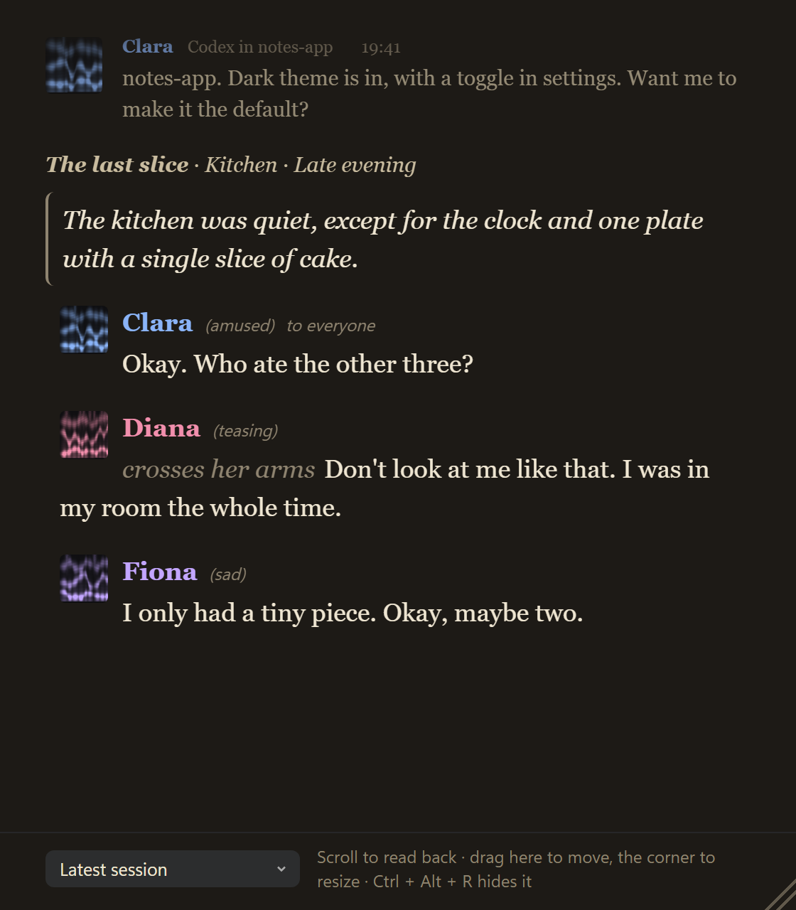
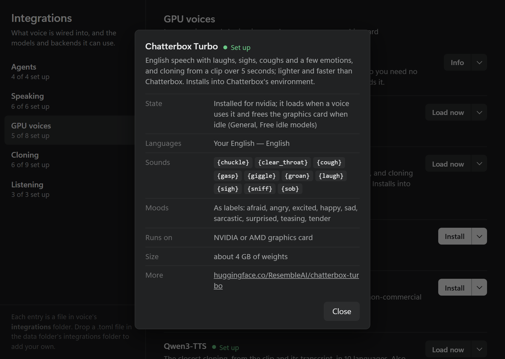

<p align="center">
  
</p>

<h1 align="center">voice</h1>

<p align="center">
  <strong>Hear your coding agents. Answer them by voice.</strong><br>
  A local MCP server that gives your AI agents a voice on Windows: agents say when they finish or need you, and you dictate back. Claude Code and Codex are set up for you; any other MCP client or LLM agent can use it too.
</p>

<p align="center">
  <a href="https://github.com/ShiroTsuma/Voice-MCP/releases/latest"></a>
  
  
  
  <a href="LICENSE"></a>
</p>

<p align="center">
  <a href="#quick-start">Quick start</a> ·
  <a href="#automatic-agent-setup">Automatic agent setup</a> ·
  <a href="#talk-to-your-agents">Talk to your agents</a> ·
  <a href="#other-agents-and-llms">Other agents and LLMs</a> ·
  <a href="#characters">Characters</a> ·
  <a href="#add-your-own-voice">Add your own voice</a> ·
  <a href="#updating-from-an-earlier-version">Updating</a> ·
  <a href="#reference">Reference</a>
</p>

<p align="center">
  
</p>

<p align="center"><em>The settings window, opened from the tray icon. Sessions, characters and lines in all screenshots are sample data.</em></p>

You run several agent sessions and none of them is on screen. voice gives each one a name and a voice: when a turn ends or an agent needs a decision, you hear it ("shop-api. Two tests fail. Should I fix them now?"). Press <kbd>Ctrl</kbd>+<kbd>Alt</kbd>+<kbd>D</kbd>, say "Anna, yes, fix them", and the message reaches that session, whether it is busy, idle or in a window you cannot see.

voice is an [MCP](https://modelcontextprotocol.io) server: any MCP client can use its tools to speak (`voice_speak`), play a scene in several voices (`voice_scene`), ask and listen for a spoken answer (`voice_listen`), control playback and characters and read the transcript (`voice_control`) and clone voices (`voice_clone`); see [MCP tools](#mcp-tools). For Claude Code and Codex it adds hooks and a Claude Code mod, so announcements and dictation work even when the agent does not call a tool. Any other agent gets the same through the [session API](docs/http-api.md), with [examples/agent.py](examples/agent.py) as a starting point.

Everything runs on your PC. Speech synthesis (Kokoro, Piper, Supertonic, Pocket) and recognition (Parakeet, Whisper) run on the CPU through sherpa-onnx; nothing you say leaves the machine. One Go binary that installs itself.

| You want to | voice does |
| --- | --- |
| Know when an agent is done | Hooks announce finished turns and permission prompts with the project and the gist of the last message |
| Answer without switching windows | Dictation goes to the agent you name, or the one that spoke last; a busy agent gets it after its current step |
| Answer a question dialog | A question the agent asks is read aloud with its choices, and what you dictate answers it |
| Keep sessions apart | Each session plays a character with its own name, voice, colour and personality |
| Follow along | A transcript of everything said and dictated, and an optional corner popup while an agent speaks or while you dictate, with your words as they are heard |
| Use your own voice | Clone a voice from a 5 to 15 second recording, from the microphone or a file |
| Use another agent | Any agent, including one on a local model, can register over a small HTTP API, take dictation, speak, announce its turns and message other sessions: [docs/http-api.md](docs/http-api.md) |
| Stay in control | Hotkeys to stop and mute, ducking of other apps, Esc or "cancel" to drop a dictation |


## Quick start

**Requirements:** Windows 10 or 11 (x64) with WebView2 (included in Windows 11), Claude Code and/or Codex, a microphone for dictation. About 1 GB of disk for the default models.

1. Download `voice-windows-x64.zip` and `SHA256SUMS` from the [latest release](https://github.com/ShiroTsuma/Voice-MCP/releases/latest). Check the archive (`Get-FileHash .\voice-windows-x64.zip` must match `SHA256SUMS`), then extract it to a permanent folder, for example `%LOCALAPPDATA%\voice`.

2. Close Codex and Claude Code, open a terminal in that folder and run:

   ```powershell
   .\voice.exe install                      # or: .\voice.exe install -data-root D:\voice-data
   ```

   This registers the MCP server in Codex and Claude Code, adds the voice skill and the hooks, and installs the Claude Code mod when the `claude` command is on PATH. `-data-root` keeps the models off the system drive. [What the install changes](#what-the-install-changes) lists every file it touches.

3. Download the voices and the recognizer, and check that you hear it:

   ```powershell
   .\voice.exe models pull runtime kokoro vad asr-parakeet
   .\voice.exe say "Hello. I will tell you when your agents need you."
   ```

   Without the models, voice falls back to the Windows voices.

4. Start Codex and Claude Code again. In Codex, run `/hooks` once and trust voice's hooks.

5. Click the tray icon to open the settings. Turn on **Start at login** in the tray menu if you want the hotkeys ready right after you sign in.

   

   *Each group opens in place, and every setting applies at once. Hotkeys are set by pressing them.*

**Windows Defender** sometimes quarantines unsigned Go programs such as `voice.exe` (for example as Wacatac). Compare the archive with `SHA256SUMS` before trusting it, then restore the file and add an exclusion for the folder you extracted it to.

## Automatic agent setup

Paste this prompt into Claude Code or Codex. The agent needs to download files, run local commands and edit its configuration:

```text
Set up voice from https://github.com/ShiroTsuma/Voice-MCP on this Windows PC.
Read the repository README first. Ask me only for what is missing: the
folder to install voice in (default %LOCALAPPDATA%\voice) and, optionally,
a folder for the speech models (a few GB; default inside the install folder).

Download voice-windows-x64.zip and SHA256SUMS from the latest GitHub release
of that repository. Check the archive's SHA-256 against SHA256SUMS before
extracting it. If there is no release or the checksum differs, stop and tell
me; do not build from source or download from anywhere else.

If voice is already installed there, tell me to close Codex and Claude Code
before replacing it, and wait for me. Extract the archive into the install
folder, then run from it:
  voice.exe install [-data-root <models folder>]
Keep all other MCP servers, hooks and settings as they are.

Download the default models and test the voice:
  voice.exe models pull runtime kokoro vad asr-parakeet
  voice.exe say "voice is installed"
and ask me whether I heard it.

Finish by telling me the manual steps: restart my agent sessions, run /hooks
in Codex and trust voice's hooks, and press Ctrl+Alt+D to try dictation.
Do not clone voices, change voice settings or turn on start at login.
```

The agent installs and tests voice. Trusting the Codex hooks, restarting sessions and the first dictation stay with you.

## Talk to your agents

**Hearing them.** voice speaks when an agent finishes a turn, asks for permission or asks you a question. The agent can also speak for itself through the `voice_speak` tool, which its skill tells it to use rarely and briefly. With **Answer by voice** on (Speaking), an agent that you dictated to says the key point of its answer aloud too. To work mostly by voice without reading the console, set **Says aloud** (Characters window) to **Most of it** or **Nearly all**: the agent then says much more of each reply aloud (see [Characters](#characters)).

<table>
  <tr>
    <td align="center" valign="top"><br><em>The corner popup while an agent speaks: the words fill in as they are heard. It takes no clicks or focus and stays while you dictate.</em></td>
    <td align="center" valign="top"><br><em>The transcript: what each agent said and what you dictated, with where it went.</em></td>
  </tr>
</table>

**Answering them.** Press <kbd>Ctrl</kbd>+<kbd>Alt</kbd>+<kbd>D</kbd>, speak, then pause for two seconds or press the hotkey again. Your words appear in the settings window as you say them; at the end the whole recording is transcribed offline once more and delivered:

- **to the agent you name**: start with its name ("Clara, add a dark theme"), or put it right after a short reply ("Sure, Clara. Remove them."), with **Pick the agent by name** on (Dictation). The words an address is read by (openers, "everyone", ...) come from per-language files; a JSON file of your own in the data folder's `addressing` folder adds words or another language;
- otherwise **to the agent that spoke last**, the one you just heard, when it spoke in the last ten minutes; else to the one most recently at work.

While you speak, the settings window and the corner popup show who it will reach ("You to Anna"), and switch as soon as you say another session's name, so a message never goes somewhere you did not see. A name shown there is where it goes: the last transcription of the whole recording may polish the words, but it does not send the message elsewhere when it hears the name otherwise.

How it arrives depends on the agent's state:

| The agent is | What happens |
| --- | --- |
| Working (Claude Code or Codex) | voice says "Passing it on" and queues it. The agent gets it after its current step and takes it into account without stopping |
| Idle, Claude Code with the voice mod | The mod submits it as your prompt, on screen or not |
| Idle, Codex | It goes into Codex's own queue (`codex queue`), which the app picks up even when the conversation is not in front |
| Idle, anything else | It is typed into the agent's terminal or window; with **Press Enter** on, it is sent at once |
| Asking you a question (Claude Code) | What you say answers the dialog, as if you had typed it under "Other" |

Press <kbd>Esc</kbd> while dictating to drop the recording. Saying "cancel" alone, or ending with a sentence of its own such as "Scrap it." or "Cancel it.", drops it too; "start over" begins again. Nothing that could not be delivered is lost: it lands on the clipboard and voice tells you so.

## Other agents and LLMs

voice is not tied to Claude Code and Codex. They are the two it sets up for you; anything else connects in one of two ways.

**Any MCP client.** Desktop chat apps, editors and agent frameworks that speak MCP get the same tools: `voice_speak`, `voice_scene`, `voice_listen`, `voice_control` and `voice_clone`. Add voice as a stdio server; most clients take this form in their MCP settings (paths from `mcp-install`; `voice paths` shows yours):

```json
{
  "mcpServers": {
    "voice": {
      "command": "C:\\Users\\you\\.agents\\bin\\shared-mcp.exe",
      "args": ["--idle-seconds", "300", "--", "C:\\Users\\you\\.agents\\tools\\voice\\binary-runtime\\voice.exe", "mcp"]
    }
  }
}
```

The server's instructions tell the model when to speak and how briefly, so a client needs nothing else. What only Claude Code and Codex have are the hooks: there, voice announces a finished turn and passes dictation to a busy agent even when the model calls no tool. In another client the model speaks when it calls `voice_speak`, and your dictation reaches it as typed text in its window, or through `voice_listen` when the model asks.

**Any LLM agent, with or without MCP.** An agent loop of your own, on a cloud model or a local one (Ollama, LM Studio, llama.cpp: anything with an OpenAI-compatible API), uses the small [session API](docs/http-api.md) over HTTP on this PC: it registers a session with a name, says what it wants said, reports when its turn ends, and polls for what you dictate to it, busy or idle, just like the built-in clients. [examples/agent.py](examples/agent.py) is a complete agent in plain Python on a local model:

```powershell
python examples/agent.py --name Mira --model qwen2.5:0.5b
```

Then say "Mira, hello": it answers aloud, and its turns show in the transcript beside your other sessions. A reply that starts with "@Name:" goes to another session, so agents can talk to each other.

## Characters

Sessions take their names from a list of characters (settings window → Characters). Each has a name, personality traits, an optional description in your own words, a voice, a colour for its light and an optional picture. **Also written as** lists the spellings speech recognition gives its name ("Alana" for Anna): a dictation that says one reaches that character, and the text shows the name. A new session takes the first character no other session uses; the first one (★) is the default. Drag characters in the list to change that order.

Two settings decide how much of the character the agent shows, for all characters at the top of the Characters window and for one in its editor:

- **Immersion**, how strongly it steers: **Light** (its tone in written replies; speech short and plain), **Voice** (the default: its tone and attitude everywhere, speech short but in character), **Full** (it is the character in all it writes and says, with opinions and moods, and says as much aloud as it would), **Role-play** (it behaves as the person described: it may criticise instead of helping, or refuse; it never harms the work or your files and never lies about what it did, and a message starting "Clara, out of character: ..." gets a plain answer). Below Role-play the work is always done in full.
- **Reminders**, how often the agent is reminded of its character, counted in your messages: only at the start, every message, every 3 (the default), 5, 10 or any number. A reminder is one line (name and traits), or the whole description at Full and Role-play; the editor shows what that costs in tokens. The whole description also goes out at the start and with your next message after a change: another character, or this one edited (its traits, description or immersion), even in a session already running.

With characters off, agents get none of this.

A third setting sits beside them, for all sessions at the top of the Characters window and for one character in its editor:

- **Says aloud**, how much of each reply the agent says aloud: **Short** (the default: a sentence or two when it finishes something or needs you; details on screen), **Most of it** (the substance of each reply: what it did, found or decided, what is left and what it needs from you; code, paths, logs and lists stay on screen, and it says in a few words what they hold) or **Nearly all** (the whole reply as it would tell you in person, but code, paths, links and raw output). It is for working by voice without reading the console. Above Short, the agent is told at the start, with the reminders and once after a change, sends a long reply in pieces of one turn so it plays as one utterance, and its spoken lines may be as long as the narrative style's. Unlike the other two it also applies with characters off: sessions without a character follow the general level.


*The characters window: personality traits, a description in your own words, a voice, a colour and an optional picture.*

Change a session's character by right-clicking it in the settings window, with `/character` in Claude Code (`/character Rebekka` switches at once; without a name it asks), or with `$character` in Codex.

With **Give sessions characters** on, the agent plays its character in every reply, written and spoken, and speaks with its voice. The character changes only the tone: the agent still works correctly and keeps helping. Off, the names still route dictation, and agents keep their usual tone and the default voice.

## Stories and scenes

A session can speak in a **narrative style** instead of the usual sentence or two: ask your agent for a story or a role-play, and it switches with `voice_control` `set_style narrative` (`short` switches back; it is per session, so coding sessions keep their brevity). Each reply is then said in full, and the length limit rises to 4000 characters a line.

When characters speak, the agent passes the whole scene in **one** `voice_scene` call (`voice_speak` stays for short messages): `lines`, each in its own voice (a character's name or a preset), heard as one piece with a short breath between voices, and the transcript keeps who said what. Its `mode` says how: `play` is heard while it renders; `render` renders all of it first, one engine at a time, then plays it as one recording, so a scene across GPU models that do not fit on the card together (Qwen3-TTS and Higgs, say) does not swap them line by line; `auto`, the default, renders first exactly then. `save_to` writes a scene (or a single line) to a WAV or MP3 file instead. One line in another voice works on `voice_speak` too: `voice`.

```json
{ "lines": [
  { "text": "The tavern falls quiet as the door creaks open.", "voice": "narrator" },
  { "text": "Well, look who finally showed up.", "voice": "Rebekka", "pause": 1.5 },
  { "pause": 2 },
  { "text": "Hush. Come, sit by the fire.", "voice": "Anna" } ] }
```

`pause` sets the silence after a line in seconds (up to 10); a line with only a pause is a break between beats or scenes.

Text can carry voice's own tags: `{laugh}`, `{sigh}`, `{cough}` and the other sounds, and `{pause}` or `{pause:1.5}`. Each engine declares, in one form, which sounds it makes and how it shows a `mood` (none, intensity, labels or an instruction); voice turns a tag into the engine's own token or drops it, so a tag is never read aloud, and `*laughs*` in prose counts as `{laugh}`. Integrations shows each voice engine's sounds and moods, and `voice_control list_presets` gives them per voice. Of the engines voice runs itself, Chatterbox shows moods (as intensity); **Chatterbox Turbo** (English) makes laughs, sighs, coughs and more and shows a few moods as labels; **OmniVoice** (600+ languages) laughs and sighs. **Higgs Audio v3** makes sounds and shows moods, on a speech server of your own ([docs/higgs-audio.md](docs/higgs-audio.md)); Integrations sets that server's address. `{pause}` works with all of them.

A line can also carry what is shown and never spoken: `kind` (`dialogue`, `narration` or `thought`), `mood`, `action` (a stage direction; a line with only an action is shown, not said) and `to` (whom it is said to). `scene` on the call gives the `title`, `location`, `time` and a `background` name. voice keeps all of it in the transcript and writes it into the reading window; the built-in look shows only some, and a theme decides the rest. Nothing of it goes back to the agent.

Kokoro's 54 voices suit a crowd of side characters (they run on the CPU at once); keep the GPU voices for one or two leads.

The corner popup is small for a scene. Like a game overlay, **Reading window key** in the settings shows a large window with the transcript as a log, and hides it again; nothing else opens it. Each speaker of a scene gets their own line in their colour, the message being said fills in as it is heard, and your dictation shows as it is heard. Scroll back with the mouse wheel, move it by its bottom bar and resize it from its corner. The bar also picks what it shows: the session that spoke last (the default), all sessions mixed as they came, or one session, so a story is not interrupted by a coding session's announcements. While it shows one session that tells a story (narrative style), it uses the **Story theme** from the settings, unless the session chose a theme of its own: an agent can give its session a theme with `voice_control` `set_theme` (`list_themes` lists them), for example a role-play skill's, without changing yours. **Words appear** shows each word as it is said, or the whole message at once with the word being said marked.

<p align="center"></p>

<p align="center"><em>The reading window with a scene in a story theme: the setting, narration, each speaker in their colour with their mood, a stage direction and whom a line is said to.</em></p>

### Reading window themes

A theme is a folder with a `theme.css`, plus any pictures or fonts it uses (relative `url()`s work). `voice theme install <folder>` copies one into voice (a package's installer can call it without knowing where voice keeps its data); `voice theme list`, `voice theme remove <name>` and `voice theme path` do the rest. Pick it under **Reading window theme**; it loads after the built-in look and overrides it, and an edit shows the next time the window opens. A theme can be as small as this, which hides each scene's message header so its lines stand alone:

```css
.msg.scene { grid-template-columns: 1fr; }
.msg.scene > .pic, .msg.scene .head { display: none; }
```

What the page writes for a theme to use (the built-in look hides the parts marked hidden):

| Element | Data attributes | What it is |
| --- | --- | --- |
| `body` | `data-theme`, `data-speaker` | the theme; who speaks now. Classes `words` or `block` (Words appear), `pinned` (opened with the key) |
| `.msg` (`.said`, `.dictated`, `.scene`, `.live`, `.last`, `.cut`) | `data-kind`, `data-speaker`, `data-client`, `data-project`, `data-source`, `data-to`, `data-scene`, `data-background` | one message |
| `.msg > .pic`, `.body`, `.head` with `.name`, `.where`, `.state`, `time` | | portrait or voiceprint, who, where from, speaking or getting ready, when |
| `.setting` with `.title`, `.location`, `.time` (hidden) | `data-background` | a scene's setting |
| `.lines` > `.line` (`.speaking` while said) | `data-speaker`, `data-voice`, `data-kind`, `data-mood`, `data-to`, `data-pause`, `data-action`, `data-spoken`, `data-narrator`, `data-index` | one line of a scene |
| `.line` > `.line-pic`, `.meta` with `.name`, `.mood` (hidden), `.to` (hidden), `.voice` (hidden); `.action`; `.text` | | its speaker, how and to whom, the stage direction, the words |
| `.w` (`.later`, `.now`, `.unsaid`, `.aside`) | | a word: not said yet, being said, never heard (the message was cut short: `.cut`), shown but never spoken (a display text's narration) |
| `#hint`, `#dict` | | the bar shown when opened with the key; your dictation as it is heard |

Variables: `--ground`, `--ink`, `--ink-2`, `--ink-3`, `--you`, `--plain`, `--ui`, `--ui-display`; `--light` is the message's speaker colour and `--c` a scene line's.
## Add your own voice

A voice comes in three layers, each in `config.toml` next to `voice.exe` (create it from `config.example.toml`):

1. An **engine** makes the sound. Kokoro, Piper, Supertonic 3, Windows SAPI and the Python sidecar's backends (Chatterbox Multilingual V3, Chatterbox Turbo, XTTS, F5, Qwen3-TTS, Qwen3-TTS fast, OmniVoice on the GPU; Chatterbox Nano on the processor) are built in. Any program that writes a WAV file can be another one (`type = "exec"`), and so can any server that speaks voice's HTTP protocol (`type = "http"`).
2. A **preset** picks an engine and tunes it: voice, speed, pitch, effects, another engine or voice for another language. The built-in `calm-mature` is Kokoro's `af_nicole`, slower and lower.
3. A **character** speaks with a preset. Pick it in the Characters window (Voice), or set `preset` in its `[[characters]]` entry.

The GPU engines and the models install from **Integrations** (settings window or tray menu), one button each:



*Each entry's other actions are on its arrow; Info and settings shows the languages it speaks, the sounds and moods it makes, the graphics cards it runs on, and settings such as a model size or a server's address.*

For example, Chatterbox's own voice for one character, and a program of your own for another:

```toml
# 2. A preset on a built-in engine (install Chatterbox in Integrations first).
[presets.rebekka-voice]
engine = "chatterbox"
description = "Chatterbox, 23 languages"

# 1. An engine of your own: any command that turns text into a WAV.
#    Placeholders: {text} {voice} {lang} {speed} {wpm} {out}; without {text}
#    the text goes to stdin, with {out} the WAV is read from that file.
[engines.my-tts]
type = "exec"
command = 'D:\tools\my-tts\my-tts.exe'
args = ["--text", "{text}", "--out", "{out}"]

[presets.clara-voice]
engine = "my-tts"
description = "My own TTS"
speed = 0.95
dsp = ["compress:soft", "reverb:room"]

# 3. Characters with those presets.
[[characters]]
name = "Rebekka"
traits = ["teasing", "playful"]
preset = "rebekka-voice"

[[characters]]
name = "Clara"
traits = ["calm", "formal"]
preset = "clara-voice"
```

`voice presets` lists the presets with their engines, and **Hear it** in the settings window plays one. Cloning makes a preset for you: `voice clone add me clip.wav -engine chatterbox` creates the preset `me`. More engine and preset fields are in [config.example.toml](config.example.toml).

**Show it in the Integrations window.** When your engine has something to install, a TOML file in the data folder's `integrations` folder (`voice paths` shows where) puts it in the window, with its state and the commands behind its buttons:

```toml
id    = "my-tts"
group = "speech"
title = "My TTS"
about = "My own text-to-speech for the Clara voice."
[check]
path = 'D:\tools\my-tts\my-tts.exe'
[[actions]]
id = "install"
label = "Install"
when = "missing"
long = true
primary = true
command = ["powershell", "-NoProfile", "-File", 'D:\tools\my-tts\install.ps1']
```

The window lists what can be installed; the preset in `config.toml` is what makes a character use it. [integrations/README.md](integrations/README.md) has every field, the built-in handlers and dependencies between integrations (`requires`).

## Updating from an earlier version

Close Codex and Claude Code, extract the new release over the old folder (your `config.toml`, `settings.toml`, models and voices stay), then run `.\voice.exe install` again. It stops the running copy first and redoes the client setup. After it:

**Codex**

1. Start Codex and run `/hooks`: trust voice's five hooks (`voice.exe hook codex-hooks`). Codex skips a hook until it is trusted, and asks again when a voice update changes one.
2. Restart every Codex session that was already open: a session reads its hooks and skills when it starts.
3. Check: give Codex a longer task and dictate to it while it works; it mentions your message during the turn. Dictated while it is idle, the message reaches it through `codex queue`, on screen or not. `$character` lists the characters; `$character Rebekka` switches.

**Claude Code**

1. Check that the mod is in: `claude plugin list` shows `voice@voice`, enabled. With only the Claude app (no `claude` command on PATH) it is not installed; install it by hand with the two commands in [claude-plugin/voice-dictation](claude-plugin/voice-dictation/README.md).
2. Start new sessions: the mod, its status line (the session's name) and `/character` load only in sessions started after the update.
3. Check: dictate to an idle session that is not the one on screen ("Annie, …"); it answers on its own. `/character` opens the picker.

**Both**

- Installed with `mcp-install` 0.3.9 or newer, your agents run voice through one shared gateway (`~/.agents/bin/shared-mcp.exe`): a later voice update no longer cuts them off, and a session keeps its tools without a restart. Sessions started before that install need one last restart.
- If an announcement plays twice after a turn, run `.\voice.exe install` again: an update of the Codex app may wrap voice's notify inside its own, and voice unwraps it.
- `serve.log` in the data folder shows where each dictation went (`dictation: queued … for Annie (its Claude Code mod submits them)`, `… in Codex's queue`, `… busy (its next hook passes them on)`).

---

## Reference

- [What the install changes](#what-the-install-changes)
- [How it runs](#how-it-runs)
- [Dictation in detail](#dictation-in-detail)
- [Commands](#commands) and [MCP tools](#mcp-tools)
- [Registering by hand](#registering-by-hand)
- [Voices](#voices), [Cloning](#cloning), [Listening](#listening)
- [GPU sidecar](#gpu-sidecar)
- [Storage](#storage)
- [Building from source](#building-from-source)

### What the install changes

`voice install` works from the folder voice.exe is in. It:

- creates `config.toml` from `config.example.toml` when there is none, and with `-data-root DIR` writes `data_root` into it, so models and the sidecar live off the system drive;
- Codex (when `~/.codex/config.toml` exists): an `[mcp_servers.voice]` entry running `voice.exe mcp`, with `tool_timeout_sec = 120` for `voice_listen`; the voice skill in `~/.codex/skills/voice`; `notify` = `voice hook codex`, chaining the previous notify command (announcements); SessionStart, UserPromptSubmit, PostToolUse, Stop and Interrupt hooks in `~/.codex/hooks.json` (dictation); the `$character` skill in `~/.codex/skills/character`;
- Claude Code (when `~/.claude` exists): the MCP server at user scope (`claude mcp add`, when the `claude` command is on PATH; otherwise it prints the command); the voice skill in `~/.claude/skills/voice`; Notification, Stop, SessionStart, UserPromptSubmit and PostToolUse hooks in `settings.json`, replacing earlier voice entries (the last three register the session and pass dictation on, silently); the `voice` mod (`voice@voice`, from `claude-plugin\voice-dictation`), which starts a turn with dictation in an idle session, answers question dialogs and adds `/character`.

Each client is set up only when it is installed; for one installed later, run `voice install` again. `voice uninstall` stops voice, takes it out of both clients (puts back the Codex `notify` command it chained), removes its hooks, skills and the mod, and turns off start at login; delete the folder afterwards to remove the models and settings.

voice also runs behind a shared MCP gateway (`voice setup` is the hook an installer calls); see [Registering by hand](#registering-by-hand).

### How it runs

One background process, `voice serve`, owns the audio device, the models and the speech queue. MCP servers, hooks and the CLI are thin clients that start it on demand (an MCP server starts it as soon as its client connects). That gives:

- one persistent **voice** entry with an icon in the Windows volume mixer, where its volume can be set or muted and Windows remembers it;
- a **tray icon**: switch voice, mute, stop, ducking and barge-in, open the settings window, folders and the log, restart or quit;
- a **settings window** (click the tray icon): a dark flyout above the tray with who is speaking, your last dictation, the sessions, the transcript and the settings used every day. **All settings** at its bottom opens the full window: every setting by section (voice tuning, keys, dictation details, cloning, recognition), with Characters and Integrations. Changes apply at once and go to `settings.toml`, which overlays your `config.toml`. It closes when you click elsewhere or press Esc. It renders with WebView2;
- an optional **speaking popup** (Speaking → Show who speaks): the top of the settings window in the screen corner while an agent speaks, for 4, 8 or 12 seconds after; it never takes focus or clicks, and appears too when you close the settings window mid-sentence;
- **hotkeys**: stop speaking (`Ctrl+Alt+End`), mute (`Ctrl+Alt+M`) and dictation (`Ctrl+Alt+D`);
- **ducking**: other apps play at 35% while voice speaks;
- optional **barge-in**: voice stops when you start talking (headphones);
- optional **start at login** (tray → Start at login, or `voice autostart on`): a shortcut in the Startup folder, so the tray and hotkeys are there right after you sign in;
- idle models are freed after 15 minutes (Listening and memory → Free idle models after: 5 min to never), the GPU voices' servers included; they come back on the next use. **Load the characters' voices at start** loads the voices of the default preset and the characters when voice starts, GPU servers included, so even the first sentence is not late.

`voice serve status|stop` and `voice mixer` (session volumes) help diagnose.

### Dictation in detail

voice knows the agents: the shared-mcp gateway passes each agent's process ID with its calls, and the hooks pass theirs. The recognizer is `[listen] model` (Parakeet: 25 European languages; Whisper: about 100).

- **The agent is working** (Claude Code between its `UserPromptSubmit` and `Stop` hooks, Codex between its hooks): voice queues the message. The next hook hands it over: after the current tool call as context ("the user just said ..."), or at the end of the turn, which then goes on to answer it.
- **The session runs voice's Claude Code mod**: the message waits in voice, and the mod submits it as your prompt once the session is idle, on screen or not. Nothing is typed. The status line shows the name you dictate to the session by (🎙 Annie). The mod polls voice on 127.0.0.1 every 1.5 s, with the address and token voice writes to `%APPDATA%\voice\daemon.json` while it runs; see [claude-plugin/voice-dictation](claude-plugin/voice-dictation/README.md). While a question dialog (AskUserQuestion) is open, the mod reads the question aloud and what you dictate answers it; a click still works.
- **Codex** gets the same through its own hooks, which `voice setup -clients` adds to `~/.codex/hooks.json` (`voice hook codex-hooks`): a running turn takes what you dictate as context, and its end continues with it. Codex runs a hook only once you trust it (`/hooks`). An idle Codex gets the message through `codex queue`, which the Codex app (or CLI) holding the conversation picks up and answers. The Codex app runs all its conversations in one process, so voice reaches the one that was active last.
- **Anything else idle**: voice types the message into its input. Claude Code or Codex in their desktop app: the app's window comes to the front and gets the text. In a terminal (Windows Terminal, a console, VS Code's terminal): into the agent's own console input, whatever window is in front.
- **Nothing took it**: the clipboard, and voice says so.

Typing waits until you let go of Ctrl and Alt, so ending the recording with the hotkey does not turn the text into shortcuts. `[serve] dictate_submit = true` presses Enter after typed text. `dictate_target = "console"` only uses terminal agents, `"window"` only the window in front. A server cannot start the user's turn over MCP, which is why voice types, hands over through hooks, or leaves it to the mod. `voice dictate "text"` delivers text the same way, to try it without speaking.

Characters are `[[characters]]` in `config.toml`: `name`, `traits = [...]`, `description`, `preset`, `color` and `image` (cropped to a square, kept in `data\avatars`). `[serve] personas = true` turns on **Give sessions characters**; `character_immersion` (1 light .. 4 role-play) and `character_guidance` (every N of your messages, 0 only at the start) set the two settings above, `character_aloud` (1 short, 2 most of it, 3 nearly all) sets **Says aloud**, and a character's own `immersion`, `guidance` and `aloud` override them. Claude Code learns its character from its SessionStart hook, Codex from `voice_control register`; a character changed in the settings reaches Claude Code with its next hook and Codex with its next voice call, and an agent can switch itself with `voice_control set_character` when you ask (`list_characters` shows the list).

### Commands

| Command | Purpose |
|---|---|
| `voice mcp [-preset p]` | MCP server on stdio |
| `voice say [-preset p] [-intent info\|question\|attention] [-lang en] [-out f.wav] text` | speak (or render) text |
| `voice hook claude` / `voice hook codex <json>` | announce client events; always exits 0 |
| `voice listen [-wait 15s] [-max 30s] [-json]` | record an answer and print the transcript |
| `voice dictate text` | deliver text as if it were dictated |
| `voice transcribe [-model dir] f.wav` | speech to text for a file |
| `voice clone record\|add\|list\|preview\|text\|remove` | cloned voices |
| `voice sidecar setup [-gpu ...] backend,...` | GPU voice backends (`--help` changes nothing) |
| `voice presets`, `voice voices -engine e`, `voice devices` | inspect |
| `voice models [pull name\|all]` | download runtime and models |
| `voice paths` | every data location with its size |
| `voice setup -clients` | redo the Codex and Claude Code setup |

### MCP tools

- `voice_speak(text, intent, mood, lang, interrupt, voice)` queues a short message and returns at once, with an id; `voice_control status` with that id says whether it was heard.
- `voice_scene(lines, scene, mode, save_to, lang)` says a whole scene: lines in several voices (characters or presets) with kinds, moods, stage directions and pauses. `mode`: `play` while it renders, `render` all of it first (one engine at a time, unloading a GPU model before the next), `auto` (the default) renders first when the voices need GPU models that may not fit together. `save_to` writes a WAV or MP3 file instead.
- `voice_control(action: status|stop|mute|unmute|list_presets|list_voices|set_preset|register|list_characters|set_character|set_style|list_themes|set_theme|send|transcript, ...)`. `list_voices` lists the engines' own voices on this PC (Kokoro's, Supertonic's, Piper's, Windows'), each by an id such as `kokoro/af_bella` that works as a voice or preset anywhere; the Voices window turns voices or whole engines off, and those are left out. `send` passes a message (`text`) to another agent session by its name (`to`), for example to ask it for a second opinion; it arrives the way your dictation does, says who sent it and how to answer, and the transcript and reading window show it. Two sessions can exchange 4 messages a minute. `transcript` returns the newest lines of what voice said and what the user dictated, with the session each was for and where it went; `session` filters by a session's or character's name (or `me`), `limit` sets how many (20 by default, 50 at most). The last 50 lines are kept in `transcript.json` in the data folder, so they survive a restart.
- `voice_listen(prompt, wait_seconds, max_seconds)` optionally asks aloud, then records until the user pauses and returns `{"text","lang","seconds"}`. The microphone is open only during the call, between two chimes, and no voice process speaks meanwhile.
- `voice_clone(action: record|add|design|list|preview|set_transcript|make_prompt|describe|rename|remove|groups|group|rename_group|remove_group, ...)` creates a voice from the microphone (`record`, `seconds`) or a clip (`add`); both refuse without `rights_confirmed=true`, which the agent may only pass after the user confirms they may use that voice. `design` makes a new voice from a description (Qwen3-TTS). `describe` stores the user's `description` of a voice (shown with it, and as its preset's description in `list_presets`); `rename` gives it `new_name`, and the characters, default voice and tunings that used it follow. In the settings window, Voice design lists the voices in their groups beside the one picked, where it is renamed, described or moved; New voice makes one from a description, the microphone or a sound file. Voices can be filed in the user's own groups ("D&D", "ASMR"): `groups` lists them in order with their voices, `group` moves a voice (`name`) into `group` (or, without `name`, makes an empty group), `rename_group` renames `group` to `new_group`, `remove_group` drops a group and keeps its voices; `add`, `record` and `design` take `group` for the new voice. In the settings window, Voice clone shows a section per group, and voices are dragged between them. Each voice's group is in its `voice.toml`; `groups.toml` in the voices folder keeps the groups' order.

Server instructions tell agents to speak rarely and briefly, in the language their voice speaks: `register` names it (English unless the settings or the session's character say otherwise), and a note in a later result says when it changed.

### Registering by hand

`mcp-install` does this for you. Run the server behind `shared-mcp` so all sessions share one voice process (each model loaded once, one speech queue); GPU voices load on first use and free the card after the idle time. `mute` and `set_preset` are then global; register with `-preset` per client for different voices (that starts separate backends; a cross-process lock still keeps them from talking over each other).

Claude Code:

```powershell
claude mcp add voice --scope user -- "<dir>\shared-mcp.exe" --idle-seconds 300 -- "<dir>\voice.exe" mcp
```

Codex (`~/.codex/config.toml`):

```toml
[mcp_servers.voice]
command = '<dir>\shared-mcp.exe'
args = ["--idle-seconds", "300", "--", '<dir>\voice.exe', "mcp", "-preset", "narrator"]
tool_timeout_sec = 120   # voice_listen waits for the user
```

Hooks announce the important moments: "voice. Done. The installer now registers voice in both clients." or "shop. I need your permission to use Bash." They say the project and the last sentences of the agent's message (Announcements sets how much), and stay quiet when muted, right after the agent spoke for itself, and (Claude `Stop`) after quick turns. Each client can have its own voice via `[clients]`: the shared-mcp gateway passes the calling client's name (`claude-code`, `codex-mcp-client`) with every call, and `voice mcp -client <name>` fixes it.

Claude Code (`~/.claude/settings.json`):

```json
"hooks": {
  "Notification": [{ "hooks": [{ "type": "command", "command": "\"<dir>\\voice.exe\" hook claude" }] }],
  "Stop":         [{ "hooks": [{ "type": "command", "command": "\"<dir>\\voice.exe\" hook claude" }] }]
}
```

Codex (`~/.codex/config.toml`, top level):

```toml
notify = ['<dir>\voice.exe', "hook", "codex"]
```

### Voices

Presets combine an engine, voice, speed, pitch, effects and per-language overrides; see `config.example.toml`. A cloned voice on Qwen3-TTS or Qwen3-TTS fast can also **flow** (`flow = "clip"` or `"previous"`, or Tune → Flow → Flows or Freely in the Characters window): each sentence is spoken from the one just said, so the mood carries on instead of starting fresh each time; `clip` keeps the voice's own clip beside it so the voice does not drift, `previous` flows more and can drift. Off by default, since voices differ. Built in:

| Preset | Voice |
|---|---|
| `neutral` (default) | Kokoro `af_heart` |
| `calm-mature` | Kokoro `af_nicole`, slower, lower, soft compression and room |
| `narrator` | Kokoro British `bm_george` |
| `brisk` | neutral, faster, no chime |
| `system` | Windows SAPI, no downloads |
| `<name>` | one per cloned voice, by its name (earlier versions called it `clone-<name>`, which still works) |

English is the default language (`default_lang`, Speaking language in the settings); a character can speak another one (Speaks, in the Characters window), and a preset can give a language its own engine or voice (`lang.<code>`). A session speaks, and is announced, in its character's language or the general one. Voices in other languages than English sound noticeably worse, which the settings window says when it matters.

Announcements (a turn finished, a question, a permission prompt) say the agent's own words when they are in the voice's language, else a phrase in that language. The phrases come from one JSON file per language, built in for English and Polish; a file of your own in the data folder's `phrases` folder (`de.json`, or `pl.json` to replace a list) adds a language. Keys: `done`, `input`, `permission`, `permission_tool` (`{tool}` is the tool), `question`; a language without a key falls back to English. `[hooks.phrases]` in `config.toml` replaces a kind in every language.

Engine types: `sherpa` (Kokoro, Piper/VITS, Supertonic, Pocket, ZipVoice in process), `http` (sidecar or any server speaking its protocol), `exec` (any program that writes WAV; `{ref}` and `{ref_text}` placeholders for cloning) and `sapi`.

### Cloning

In the settings window: Voice design → New voice → pick the engine (the installed ones first: Pocket on the CPU for English, Chatterbox, XTTS or OmniVoice on the GPU for other languages, Qwen3-TTS on the GPU for the closest English clone), then record from the microphone or drop a sound file. From the command line:

```powershell
voice clone record me -rights "my own voice"      # or: voice clone add me D:\clips\me.wav ...
voice clone preview me
voice say -preset me "Hello."
```

`record` counts down with three ticks, opens the microphone with a chime for 12 s (`-seconds 6..30`) and closes it with another; read a few natural sentences aloud. The recording is checked before it is used: almost silent or heavily clipped audio is refused with what to fix; quiet, slightly clipped or noisy audio is added with a warning. The clip is converted to mono 24 kHz, trimmed, capped at 15 s and normalized; 5-15 s of one clear speaker works best. Non-WAV input needs `ffmpeg` on PATH. When a recognition model is installed the clip is transcribed automatically (ZipVoice, F5 and Qwen3-TTS need the transcript). The default engine is Pocket (CPU, English); pass `-engine chatterbox`, `xtts` or `omnivoice` for other languages once the sidecar is set up.

Only clone a voice you have the right to use.

An agent can also design a new voice from a description: ask it for "a raspy older woman, slow and dry" and it calls `voice_clone` `design`. Qwen3-TTS's voice design model (downloaded on first use, about 4.5 GB, in the Qwen3-TTS environment) reads a sample sentence once in that voice; the sample becomes an ordinary cloned voice on Qwen3-TTS, so it sounds the same in every line, and a preview plays. Keep it, or have the agent remove it and try another description.

### Listening

`[listen] model` picks the recognizer: Parakeet TDT v3 (default; fast, 25 European languages) or Whisper turbo (about 100 languages, several times slower on CPU). Silero VAD ends the recording after `end_silence` seconds of quiet.

Recognizers mishear names they have never heard. voice corrects the text afterwards, with any recognizer: a word that sounds like a character's or session's name, or a project named like an identifier (`MCP-Tools`, `api-v2`), is written as that name ("Rebecca" becomes "Rebekka", "MCP tools" becomes "MCP-Tools"). Beyond names, **word lists** put right the terms a recognizer gets wrong. voice brings two, for IT terms in Polish speech (`dżejsona` → `JSON-a`, `rytmi` → `README`, `komit` → `commit`) and in English speech (`read me` → `README`, `engine x` → `nginx`). They are on for the languages you speak until you turn them on or off under Listening and memory → Word lists. A list is a JSON file: each word as it should be written, with what recognition writes instead. An empty list means match by sound alone. An ordinary lowercase word is put right only from its listed forms, so "build" does not swallow "built".

```json
{
  "id": "my-team",
  "title": "Our project names",
  "languages": ["en"],
  "words": { "Kubernetes": ["kubernetis"], "Grafana": [] }
}
```

**Import a list…** keeps it in the data folder (`<state_dir>\wordlists`), so it stays across updates. The lists voice brings sit next to `voice.exe` and improve with new versions. Your own words go under **Your words**, as a word and what is heard instead (`[listen] words` in `config.toml`, `heard -> meant` lines). **Save as a list…** turns them into a list file to share. Dictation, its live words and `voice_listen` all use them.

### GPU sidecar

```powershell
voice sidecar setup --help          # changes nothing
voice sidecar setup chatterbox      # also: f5, xtts, qwen3; -gpu auto|nvidia|amd|cpu
voice clone add me clip.wav -engine chatterbox -rights "..."
```

The easiest way is the Integrations window (settings window → Integrations → GPU voices): Install there first downloads a Python 3.12 that voice brings along (python-build-standalone, pinned by SHA-256, into `sidecar_dir\python`), so you need no Python of your own. From the command line, setup needs Python 3.12 (3.10-3.12 without AMD), or `-python <voice's python.exe>`. It looks for it through `py`, the standard install folders and PATH, and says so before installing anything if none fits (`-python C:\path\python.exe` picks one). Each backend gets its own environment in `sidecar_dir\envs\<backend>`, so one backend's pins (chatterbox pins an old torch) cannot break another; setups from before keep working from the shared `sidecar_dir\.venv`. Downloads are cached in `sidecar_dir\.pip-cache` and finished stages are recorded, so a rerun after an interruption resumes (`-force` redoes them). A GPU computation test checks PyTorch before the backend is installed. The `chatterbox`, `f5`, `xtts` and `qwen3` engines start their server on first use, log to `sidecar\<engine>.log`, keep model weights in `sidecar\models` and stay running until 10 minutes without requests. **Graphics memory for voices** (settings window → General, `gpu_budget` under `[serve]`: `off`, `one`, or a size in GB) keeps the GPU voices loaded at once within a budget, freeing the one used least recently before another loads. On Windows voice also checks the card's real free memory before a GPU voice loads, on any card (NVIDIA, AMD or Intel, read from Windows' own graphics memory counters), since other programs share it (a speech server such as Higgs, a game, training): short of room it frees its own GPU voices first, and if that is not enough the voice does not load and the error says why, instead of failing or spilling into the PC's memory and slowing everything down. The settings show what the voices your characters use may take, and a toast says when a choice goes past the budget or the card. What a backend computes from a cloned voice's clip is kept in `sidecar\voiceprints`, so the clip is analysed once; a new recording, transcript or model makes a new one. The backends are listed once, in `sidecar/backends.json`; adding another is described in [docs/adding-an-engine.md](docs/adding-an-engine.md).

**Saved voice prompts.** Qwen3-TTS saves what it computes from a cloned voice's recording as a **voice prompt** (`voices\<name>\prompt.pt`): the speaker embedding, the reference audio's codes, the transcript and the mode flags, with the model and its revision. It is made once, when the voice is cloned. Speech then needs no recording: the WAV is not read and not even looked for, so a voice made from a recording you may not keep around goes on speaking. The prompt stays in memory between sentences and is read from disk after a restart. The recording as it came is kept as `source.<ext>` next to the trimmed `ref.wav`, and the prompt is made from it. `voice clone prompt <name>` makes the prompt again, for example for the other model size; until then that size speaks from the recording. A reference description from a dataset tool works as the clip: `voice clone add narrator reference.json -engine qwen3`, where the JSON holds `audio` and `text`.

**Qwen3-TTS** (`qwen3`) clones from the clip and its transcript, not only from a speaker embedding, and comes closest to the recorded voice. It speaks ten languages: English, Chinese, Japanese, Korean, German, French, Russian, Portuguese, Spanish and Italian. For other languages use Chatterbox, XTTS or OmniVoice. The Integrations window offers two sizes: 1.7B, the default and closest, and 0.6B, lighter and about as fast. A change applies from the next sentence. On NVIDIA it runs in bfloat16 with PyTorch's SDPA attention; FlashAttention is not needed. Without a transcript it falls back to the speaker embedding alone, which sounds less alike, so voice transcribes the clip when speech recognition is installed.

**Chatterbox** (`chatterbox`) is Chatterbox Multilingual V3, the last model of the family before Resemble AI retired it in August 2026: cloning without a transcript in 23 languages, Polish among them, closer to the voice and with fewer made-up words than the original multilingual model it replaced under the same engine name, so presets and cloned voices on `chatterbox` keep working. An environment set up before V3 goes on speaking with the original model and the Integrations window offers Reinstall to update it. **Chatterbox Nano** (`chatterbox_nano`) is Turbo made small (110M), English with Turbo's sound tags and cloning, on the processor on any PC: its environment gets the CPU PyTorch whatever the card, and it takes no graphics memory. All Chatterbox models watermark their audio inaudibly (Resemble's Perth).

**Qwen3-TTS fast** (`qwen3_fast`, NVIDIA only) is the same model and the same voices run with CUDA graphs through [faster-qwen3-tts](https://github.com/andimarafioti/faster-qwen3-tts): on an RTX 5080 a sentence takes about 0.9 s instead of about 11, so speech starts about a second after it is asked for. It reads the voice prompts Qwen3-TTS makes and makes the same ones, so a cloned voice moves between the two by picking its engine. It has its own environment (`voice sidecar setup qwen3_fast`). If it does not run on a PC, Qwen3-TTS stays the choice.

GPUs: NVIDIA gets CUDA PyTorch (`-cuda cu128` default, needed for RTX 50). AMD gets AMD's ROCm PyTorch for Windows from a profile in `sidecar\profiles` (`amd-rocm-windows`: ROCm 7.2.1, PyTorch 2.9.1, Python 3.12, for Radeon RX 9070/9070 XT/9060 XT, RX 7900 XTX, RX 7700 and AI PRO R9700; driver 26.2.2 or newer). A newer ROCm release from [AMD's install page](https://rocm.docs.amd.com/projects/radeon-ryzen/en/latest/docs/install/installrad/windows/install-pytorch.html) goes in as another profile (`-profile file.json`) or with `-torch-wheels`. F5-TTS needs `torch.distributed`, which AMD's Windows build lacks: setup checks that and skips f5 before downloading it. Tested pins for a backend go in `sidecar\requirements\<backend>-<gpu>.txt` (used as pip constraints). Everything outside the sidecar (Kokoro, Piper, Supertonic, Pocket cloning, Parakeet/Whisper listening) runs on the CPU and works the same on AMD and NVIDIA.

Model licenses vary (Pocket, F5 weights and XTTS are non-commercial); check them before any commercial use.

### Storage

Models (~3 GB with everything) and the GPU sidecar (PyTorch plus weights, 5-10 GB per backend) add up. By default data lives next to `voice.exe`; move it off a full system drive in `config.toml`:

```toml
data_root = 'D:\voice-data'     # models, runtime, voices, data, sidecar below it
# or one part at a time; relative values are relative to data_root
sidecar_dir = 'E:\big\voice-sidecar'
```

`voice paths` prints every location with its size. The sidecar's pip downloads, build files and Hugging Face weights also stay in `sidecar_dir`. Only `config.toml` and the small `sidecar\voice_sidecar` code stay next to `voice.exe`.

### Building from source

Needs Go (the version in `go.mod`) on PATH; nothing else for the product build.

```powershell
.\build.ps1 -Test                       # bin\voice.exe, after go vet and go test
bin\voice.exe models pull runtime kokoro vad asr-parakeet
bin\voice.exe say -intent question "All done. Should I commit?"
.\scripts\package-release.ps1 -Version v1.0.0   # dist\voice-windows-x64.zip and SHA256SUMS
```

A release is an annotated tag (`git tag -a v1.0.1 -m "notes"`); pushing it runs `.github/workflows/release.yml`, which builds, tests and publishes the archive.

```
cmd/voice            CLI, MCP entry, tray, hotkeys, dictation delivery, install
internal/core        queue, cleanup, sentence pipelining, playback lock, cache
internal/engine/...  sherpa (DLL via syscall), httpengine, command, sapi
internal/audio       winmm output and capture, WAV, resampling, effects
internal/listen      microphone + VAD + recognizer, live phrases
internal/clones      cloned voice profiles
internal/hooks       Claude Code / Codex hook parsing and announcements
internal/mcpserver   MCP tools
internal/settingsui  settings window and characters window (HTML)
claude-plugin/       the Claude Code mod
sidecar/             Python sidecar
skills/voice         the skill agents get
```

## License

GPL-3.0-only; see [LICENSE](LICENSE). The speech models have their own licenses, and `THIRD_PARTY_NOTICES.txt` in the release lists the Go dependencies'.
